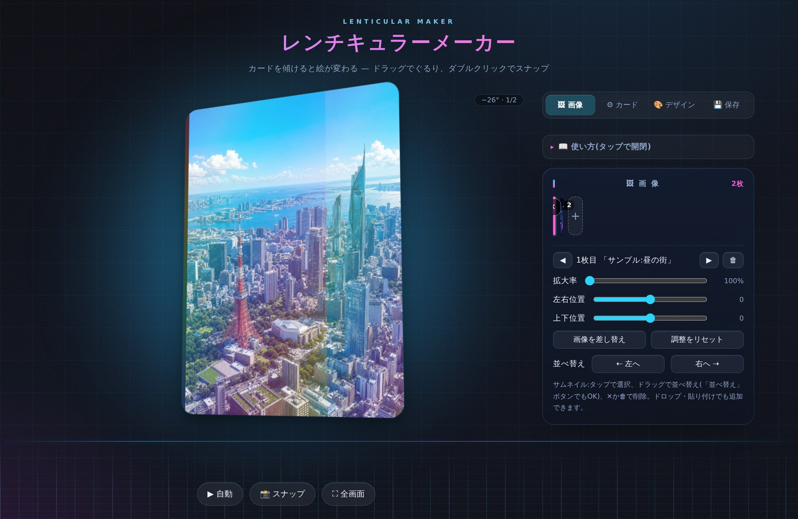

# 🌈 レンチキュラーメーカー

ブラウザだけで完結する、レンチキュラー(傾きカード)風の演出メーカー。
画像を登録してカードを傾けると、本物のレンチキュラー印刷のように絵が切り替わります。

ビルド不要・依存ライブラリなしの **HTMLファイル1枚** で動きます。



## ✨ 特徴

- **1ファイル完結** — `index.html` を置くだけで動作。フレームワークなし、ビルドなし、サーバーなし
- **プライバシー** — 画像はすべてブラウザ内で処理され、外部へ送信されません
- **豊富な傾き操作** — ドラッグ / ダブルクリックで角度スナップ / 自動で揺らす / カーソル追従(PC) / スマホの傾き(ジャイロ)
- **ホロ加工 7種** — 虹ストライプ・ハート・星形・星雪スパークル・つぶつぶ(ラメ)・モザイク・扇形。「画像の明るさで光る」で明るい部分ほどキラキラ
- **光沢と縁** — ツヤ(白)/ホロ切替、角丸・枠・影・背後のグロー、レンティカル質感の縞
- **枠画像** — 透過PNGのフレーム素材をカードに重ねられます
- **スナップショット** — 表示中のカードをそのまま PNG で保存
- **自動保存** — 画像と設定をブラウザ(localStorage)に保存。再読み込みしても復元されます
- **サイバー系ダークUI** — ネオンシアン/マゼンタ、モバイルファースト、ボタンを消す全画面モード

## 🚀 つかいはじめ

### そのまま開く

`index.html` をダウンロードしてブラウザで開くだけです。

### GitHub Pages で公開する

1. リポジトリを GitHub にアップロード(`index.html`・`README.md`・`screenshot.jpg`)
2. **Settings → Pages** で Source を `main` ブランチ / ルートに設定
3. `https://<ユーザー名>.github.io/<リポジトリ名>/` で公開されます

> 💡 iOS でジャイロ(スマホの傾き)を使うには HTTPS が必要なため、GitHub Pages での公開がおすすめです。

## 📖 つかいかた

1. 「＋」タイル(またはカードへのドロップ / 画像の貼り付け)で画像を追加
   - 追加した画像は常に **1枚目(左端)** に入ります
2. カードを **ドラッグして傾ける** と、左に傾けたとき=1枚目、右に傾けたとき=最後の画像が表示されます
3. サムネイルを選んで **拡大率・位置** を調整(サイズの違う画像を揃えるのに使います)
4. ⚙カード / 🎨デザイン タブで傾き・光沢・ホロを調整
5. **「📸 スナップ」** で表示中のカードを PNG として保存

<details>
<summary><b>各機能の詳細</b>(タップで開閉)</summary>

| 項目 | 説明 |
|---|---|
| 追加 | 「＋」タイル / カードへのドロップ / 画像の貼り付け。何枚でも登録可(見やすい目安は2〜8枚) |
| 並び | 1枚目=左に傾けた時、最後=右に傾けた時。サムネイルのドラッグか「並べ替え」ボタンで変更 |
| 調整 | サムネイル選択(または◀▶)で、その画像の拡大率・位置を個別調整 |
| 切り替えかた | なめらか=フェード / シャープ=本物のレンチキュラーっぽく一瞬で切替 |
| 傾きの感度 | カードの傾く大きさ |
| 傾き操作 | ▶ 自動(ゆらゆら揺らす)/ カーソル追従(PC)/ 📱 スマホの傾き(通常時は⚙カード設定のチェック、全画面中は✕の横の「📱 傾け」ボタン) |
| 光沢 | ツヤ(白) / ホロ(キラキラ) / なし。「画像の明るさで光る」オンで明るい部分ほど光る |
| ホロの種類 | 虹ストライプ・ハート・星形・星雪スパークル・つぶつぶ・モザイク・扇形 |
| デザイン | 角丸・枠=カードの縁 / 影=浮き出し / 背景の光の色=カードの後ろのヒカリ |
| 枠画像 | デザインタブから透過PNG(フレーム素材)をカードに重ねられる |
| 全画面 | 「⛶ 全画面」でボタン等を消してカードだけ表示。✕と「📱 傾け」は数秒で薄くなり、画面をタッチすると再表示 |
| 保存 | 画像と設定は自動保存(環境によっては無効)。長辺1600px程度に圧縮 |

</details>

## ⚠️ 枚数の目安

登録枚数に上限はありませんが、1枚あたりが見える傾きの幅は枚数で割られるため、**2〜8枚程度**が見やすい目安です。
枚数が多い時は「切り替えかた」をシャープ側にすると締まって見えます(9枚目を登録した時にお知らせします)。

## 🔧 動作環境・制限

- モダンブラウザ(Chrome / Safari / Firefox / Edge)。スマホ・タブレット対応
- **ジャイロ**: iOS では初回タップ時の許可が必要(HTTPS必須)。Android はそのまま動作
- Fullscreen API が使えない環境(iframe 埋め込みなど)では、代替の全画面モードへ自動フォールバック
- 自動保存は localStorage のため、シークレットモードなどでは無効になります

## 📁 ファイル構成

```
index.html     — アプリ本体(CSS・JS・サンプル画像もすべて1ファイルに内蔵)
README.md      — このファイル
screenshot.jpg — スクリーンショット
```

> 同梱のサンプル画像(昼/夜)はAI生成のダミーです。自由に差し替えてお使いください。

## 📝 ライセンス

MIT
